# Лабораторная работа №6. Система контроля версий
**Выполнил:** 4517 Параничев.В.К.

## Цель работы
изучение базовых возможностей системы
управления версиями, опыт работы с Git Api, опыт работы с локальным и
удаленным репозиторием. 
## Ход работы

### 1. Настройка Git и форк репозитория
Была выполнена настройка имени пользователя и email, а также создан форк исходного репозитория.
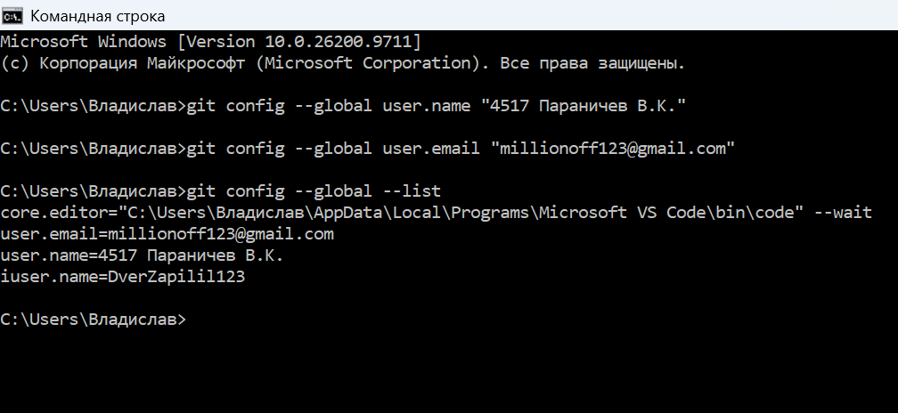
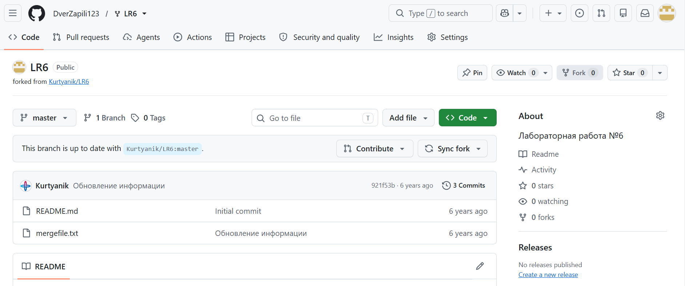

### 2. Клонирование и работа с веб-интерфейсом
Репозиторий был склонирован на локальный компьютер. Затем через веб-интерфейс GitHub был добавлен новый файл, и изменения были подтянуты локально.
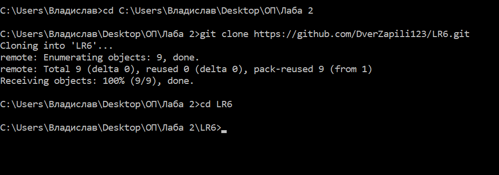
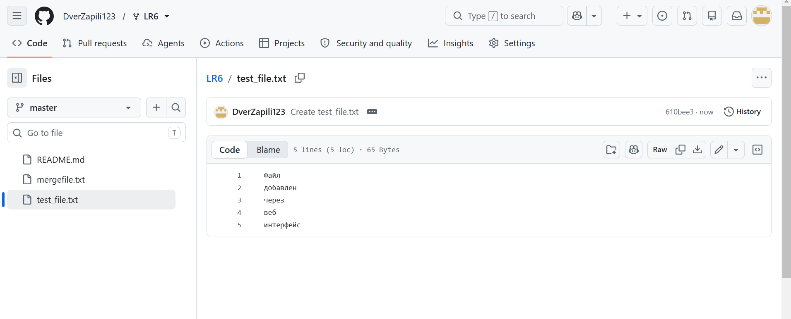
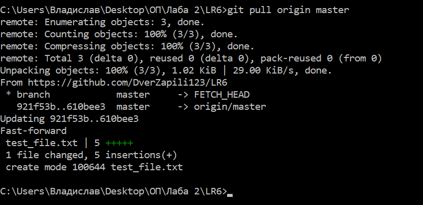

### 3. Работа с ветками и разрешение конфликта
Была просмотрена история операций. Для создания конфликта были сделаны изменения в файле в двух разных ветках.
История операций (лог):
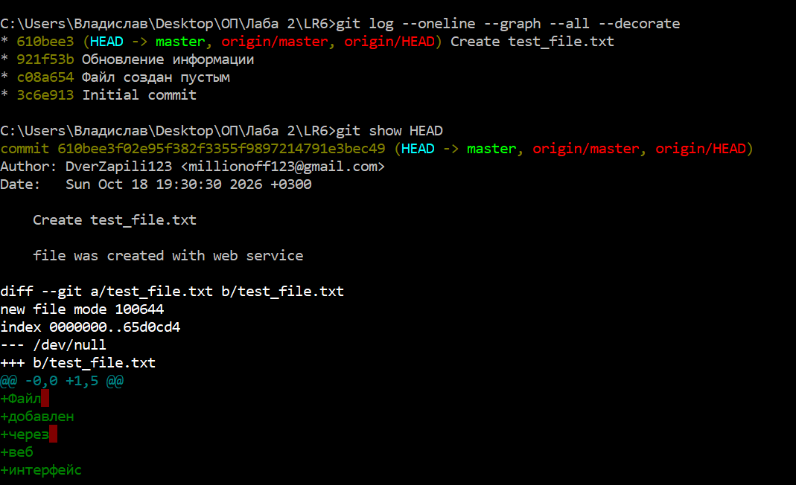

Создание ветки feature и коммит:
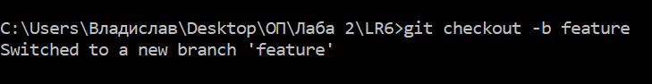
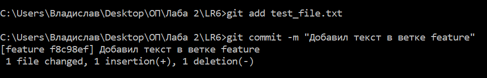

Возврат в master и коммит:
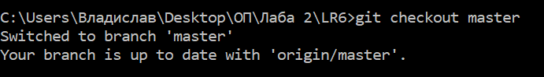
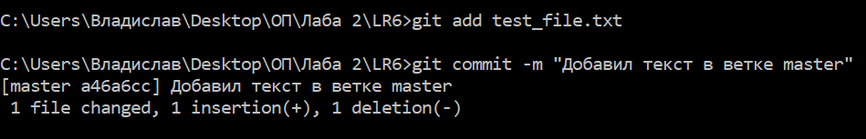

При слиянии возник конфликт, который был успешно разрешен вручную, после чего создан коммит слияния:
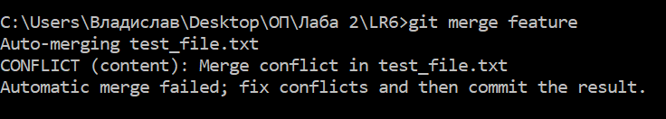
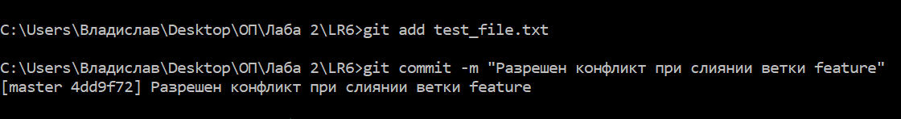

После успешного слияния побочная ветка была удалена:
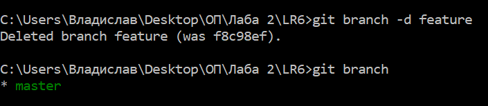

### 4. Откат коммитов
Для демонстрации отката было сделано несколько коммитов. 
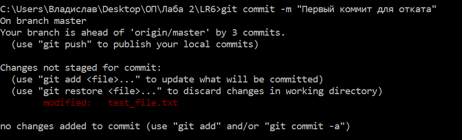
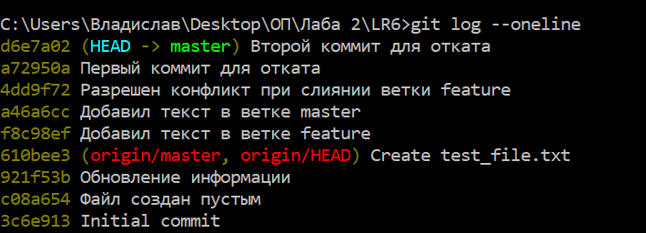

Затем последний коммит был отменен с помощью команды `git reset --hard HEAD~1`:
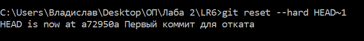


## Лог команд
```bash
git config --global user.name "4517 Параничев В.К."
git config --global user.email "millionoff123@gmail.com"
git config --global --list
cd C:\Users\Владислав\Desktop\ОП\Лаба 2
git clone https://github.com/DverZapili123/LR6.git
cd LR6
git pull origin master
git log --oneline --graph --all --decorate
git show HEAD
git checkout -b feature
git add test_file.txt
git commit -m "Добавил текст в ветке feature"
git checkout master
git add test_file.txt
git commit -m "Добавил текст в ветке master"
git merge feature
git add test_file.txt
git commit -m "Разрешен конфликт при слиянии ветки feature"
git branch -d feature
git branch
git commit -m "Первый коммит для отката"
git add test_file.txt
git commit -m "Первый коммит для отката"
git add test_file.txt
git commit -m "Второй коммит для отката"
git log --oneline
git reset --hard HEAD~1
git log --oneline
git checkout -b report


## История операций (форматированный лог)
a72950a | 2026-10-18 | 4517 Параничев В.К. | Первый коммит для отката
4dd9f72 | 2026-10-18 | 4517 Параничев В.К. | Разрешен конфликт при слиянии ветки feature
a46a6cc | 2026-10-18 | 4517 Параничев В.К. | Добавил текст в ветке master
f8c98ef | 2026-10-18 | 4517 Параничев В.К. | Добавил текст в ветке feature
610bee3 | 2026-10-18 | DverZapili123 | Create test_file.txt
921f53b | 2020-11-21 | Kurtyanik | Обновление информации
c08a654 | 2020-11-21 | Kurtyanik | Файл создан пустым
3c6e913 | 2020-11-21 | Kurtyanik | Initial commit